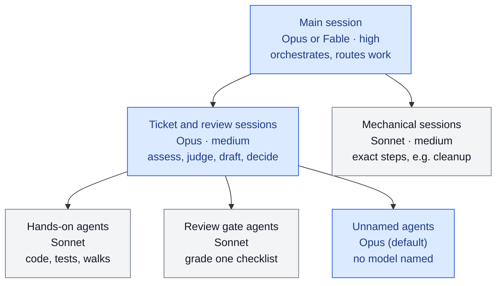

# kc-claude-kit

A personal [Claude Code](https://code.claude.com/docs) toolkit that works in any codebase. It teaches Claude how to write code, reviews code against the same rules, and checks the work in the running app before calling it done. Everything is a Claude Code plugin; install the ones you want and add nothing to your project.

## Install

Add the marketplace, then install what you want:

```
/plugin marketplace add kcsujeet/kc-claude-kit
/plugin install kc-gates@kc-claude-kit
/plugin install kc-verify@kc-claude-kit
/plugin install kc-instructions@kc-claude-kit
/plugin install kc-usage-band@kc-claude-kit
/plugin install kc-image-preview@kc-claude-kit
```

`kc-gates` brings `kc-conventions` with it. On your first prompt its hook copies two small rules into `~/.claude/rules/` (a pointer rule that names the skill to load for each kind of work, and an always-on rule with reply habits), so they load in every project. Set `KC_CONVENTIONS_AUTO_INSTALL=0` to opt out. To commit a copy into one project, run `/kc-conventions:kc-init` there.

`kc-autopilot` is a work in progress; install it only to try it: `/plugin install kc-autopilot@kc-claude-kit`.

To stay current, turn on auto-update: `/plugin`, the Marketplaces tab, `kc-claude-kit`, **Enable auto-update**.

## Plugins

| Plugin | What it is for | When you would use it |
|---|---|---|
| [`kc-gates`](plugins/kc-gates) | Code review: `kc-code-review`, `kc-ready-for-review`, `kc-post-review`, plus the hooks that guard pushes, merges and posts. | Every PR. |
| [`kc-conventions`](plugins/kc-conventions) | The coding rules (one checklist skill per topic) and the process skills (assess, shape, look back). | Always on; installed with `kc-gates`. |
| [`kc-verify`](plugins/kc-verify) | QA: the change in the running app, whether a person can use it, end to end. | Any change a person sees. |
| [`kc-instructions`](plugins/kc-instructions) | Audits a repo's Claude setup: what belongs in `CLAUDE.md`, a rule, a skill or a hook. | Once per repo. |
| [`kc-usage-band`](plugins/kc-usage-band) | A status row above the prompt: model, branch, context, rate limits, cost. | Always on. Terminal only. |
| [`kc-image-preview`](plugins/kc-image-preview) | Thumbnails of images you paste into the prompt. | Always on. Terminal on macOS only. |
| [`kc-autopilot`](plugins/kc-autopilot) 🚧 | Work in progress: turns an approved plan into pull requests. | Not ready for everyday use. |

## How it works

- **Rules are checklists.** Each topic skill in `kc-conventions` is a list of one-line boxes. Claude ticks them while writing; review ticks the same boxes.
- **A pointer rule loads the skill.** "Doing X, load skill Y" is the only rule text loaded while you work; the skill loads when the work needs it.
- **Review is one agent per topic.** `kc-code-review` runs the gate agents, scripts count every receipt, and the result is one PASSED or FAILED in chat. Nothing is posted without your say-so.
- **Hooks hold what must not be skipped.** A guard blocks an unreviewed push, an unapproved post or a merge on a red round; it costs nothing until it fires.
- **One pass before a human sees the PR.** `kc-ready-for-review` runs `kc-code-review` (which includes the one QA walk), your repo's hand-off checklist and CI's commands once, fixes what it finds and proves each fix with a test.

## Start here

| When | Type or say | What happens |
|---|---|---|
| Your PR is about to go to a reviewer | `/kc-gates:kc-ready-for-review` | One review and QA pass on your own PR, fixes with tests, a short list left for you. |
| You review a PR (or want yours checked) | "review this PR" | `kc-code-review` reports PASSED or FAILED, one line per finding. |
| You want findings as PR comments | `/kc-gates:kc-post-review` | Drafts short comments, shows them, posts only after you say so. |

## Who runs on which model

Strongest model decides; mid model executes work it is handed. Details in [`kc-delegate`](plugins/kc-conventions/skills/kc-delegate/SKILL.md).



## Every skill, in one line

Most start on their own when the topic comes up; you can type any as `/plugin:skill`.

**[`kc-gates`](plugins/kc-gates):** [`kc-code-review`](plugins/kc-gates/skills/kc-code-review/SKILL.md) (review a PR, branch or changes, walking every changed behaviour: the one QA, own PRs and others'), [`kc-ready-for-review`](plugins/kc-gates/skills/kc-ready-for-review/SKILL.md) (the one review and QA pass on your own PR), [`kc-post-review`](plugins/kc-gates/skills/kc-post-review/SKILL.md) (draft PR comments and replies, post on your signal).

**[`kc-verify`](plugins/kc-verify):** [`kc-ui`](plugins/kc-verify/skills/kc-ui/SKILL.md) (the change rendered, every state), [`kc-ux`](plugins/kc-verify/skills/kc-ux/SKILL.md) (a person can use it), [`kc-e2e`](plugins/kc-verify/skills/kc-e2e/SKILL.md) (every layer, front to back).

**[`kc-conventions`](plugins/kc-conventions), topics:** [`kc-naming`](plugins/kc-conventions/skills/kc-naming/SKILL.md), [`kc-clarity`](plugins/kc-conventions/skills/kc-clarity/SKILL.md), [`kc-structure`](plugins/kc-conventions/skills/kc-structure/SKILL.md), [`kc-simplicity`](plugins/kc-conventions/skills/kc-simplicity/SKILL.md), [`kc-correctness`](plugins/kc-conventions/skills/kc-correctness/SKILL.md), [`kc-testing`](plugins/kc-conventions/skills/kc-testing/SKILL.md), [`kc-datetime`](plugins/kc-conventions/skills/kc-datetime/SKILL.md), [`kc-security`](plugins/kc-conventions/skills/kc-security/SKILL.md), [`kc-i18n`](plugins/kc-conventions/skills/kc-i18n/SKILL.md), [`kc-react`](plugins/kc-conventions/skills/kc-react/SKILL.md), [`kc-rails`](plugins/kc-conventions/skills/kc-rails/SKILL.md), [`kc-type-safety`](plugins/kc-conventions/skills/kc-type-safety/SKILL.md), [`kc-error-handling`](plugins/kc-conventions/skills/kc-error-handling/SKILL.md), [`kc-performance`](plugins/kc-conventions/skills/kc-performance/SKILL.md), [`kc-dependencies`](plugins/kc-conventions/skills/kc-dependencies/SKILL.md).

**[`kc-conventions`](plugins/kc-conventions), process:** [`kc-do-a-task`](plugins/kc-conventions/skills/kc-do-a-task/SKILL.md) (the order of work, assess to look-back), [`kc-assess`](plugins/kc-conventions/skills/kc-assess/SKILL.md) (reproduce first, every reader of the broken value), [`kc-shape-the-change`](plugins/kc-conventions/skills/kc-shape-the-change/SKILL.md) (write and compare the design before code; a hook blocks source edits until it passes), [`kc-investigate`](plugins/kc-conventions/skills/kc-investigate/SKILL.md) (production problems from existing records), [`kc-look-back`](plugins/kc-conventions/skills/kc-look-back/SKILL.md) (feedback to lessons), [`kc-raise-the-bar`](plugins/kc-conventions/skills/kc-raise-the-bar/SKILL.md) (measure, look for a better way), [`kc-check-claims`](plugins/kc-conventions/skills/kc-check-claims/SKILL.md) (check a claim before stating it), [`kc-delegate`](plugins/kc-conventions/skills/kc-delegate/SKILL.md) (hand work to agents without the cost running away), [`kc-init`](plugins/kc-conventions/skills/kc-init/SKILL.md) (copy the rules into a project).

**[`kc-instructions`](plugins/kc-instructions):** [`kc-audit`](plugins/kc-instructions/skills/kc-audit/SKILL.md) (review a repo's Claude instructions). **[`kc-autopilot`](plugins/kc-autopilot) 🚧:** [`kc-init`](plugins/kc-autopilot/skills/kc-init/SKILL.md), [`kc-run`](plugins/kc-autopilot/skills/kc-run/SKILL.md).

`kc-usage-band` and `kc-image-preview` have no skills.

## Make it yours

Four optional files in your repo teach the kit what it cannot know:

| File | What it adds |
|---|---|
| `.claude/review-conventions.md` | Your project's review rules. They win over the built-in ones. |
| `.claude/hand-off-checklist.md` | What to check before a PR goes to review: description, ticket, linked PRs. |
| `.claude/sensitive-paths.txt` | Paths to treat as risky, beyond the built-in list. |
| `.claude/public-paths.txt` | Paths a signed-out visitor reaches (one extended regex per line); a change to one makes the review walk the page signed out. |

## More detail

Layout, conventions, versioning and tests: [`docs/architecture.md`](docs/architecture.md).
